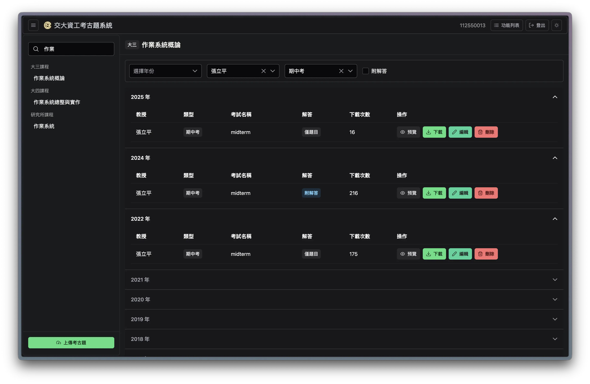
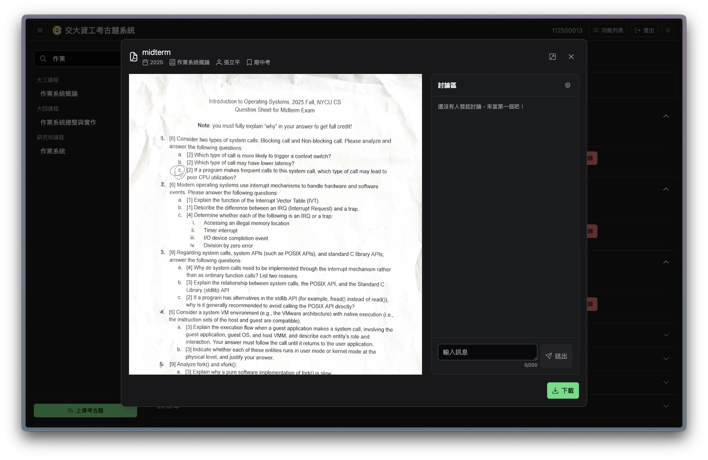
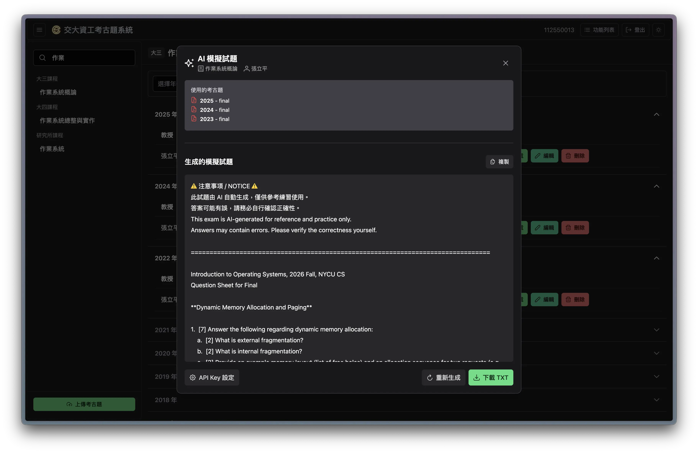

<div align="center">
  <picture>
    <source media="(prefers-color-scheme: dark)" srcset="https://github.com/user-attachments/assets/2950f4b0-f11d-46e4-98fb-28c0e701dcbc">
    <source media="(prefers-color-scheme: light)" srcset="https://github.com/user-attachments/assets/6125c7f1-5e26-4cfc-93dc-67a77720011d">
    
  </picture>
  <h3>交大資工考古題系統</h3>
  <a href="https://github.com/NCTUCSUnion/pastexam/actions/workflows/main.yml"></a>
  <a href="https://github.com/NCTUCSUnion/pastexam/releases/latest"></a>
  
  
</div>

---

## 簡介

交大資工考古題系統是由國立陽明交通大學資訊工程學系學會（NCTUCSUnion）開發與維護的考古題平台，提供系上同學瀏覽、下載與分享歷年考試題目及解答。使用者以陽明交大帳號（NYCU OAuth）登入。

<p align="center">
  <picture>
    <source media="(prefers-color-scheme: dark)" srcset="https://raw.githubusercontent.com/NCTUCSUnion/pastexam/umami/umami-dark.png">
    
  </picture>
</p>

## 功能

- **瀏覽與篩選**：依課程分類瀏覽考古題，並可依年份、授課教師、考試類型及是否附解答篩選。
- **線上預覽與下載**：直接於瀏覽器預覽 PDF，或下載原始檔案。
- **上傳**：登入使用者可上傳 PDF 考古題（單檔上限 10 MB）；管理員可編輯資訊或將考古題移至其他課程。
- **討論區**：每份考古題皆有即時討論區，訊息透過 WebSocket 同步。
- **AI 模擬試題**：選取考古題後，以 Google Gemini 生成模擬試題。使用者需自行設定 Gemini API Key，Key 加密後儲存。
- **管理後台**：管理課程、使用者與系統公告。

## 介面預覽

### 搜尋介面
<p align="center">
  
</p>

### 文件預覽與討論區
<p align="center">
  
</p>

### AI 模擬試題
<p align="center">
  
</p>

## 架構

| 元件 | 技術 | 說明 |
| :--- | :--- | :--- |
| `frontend` | Vue 3、Vite、PrimeVue、Tailwind CSS | 單頁應用程式 |
| `backend` | Python 3.12、FastAPI、SQLModel、Alembic | API 與 WebSocket，啟動時自動執行資料庫遷移 |
| `worker` | ARQ | 背景工作，處理 AI 模擬試題生成 |
| `db` | PostgreSQL | 主要資料庫 |
| `redis` | Redis | 快取、統計、請求頻率限制、討論區訊息廣播與工作佇列 |
| `rustfs` | RustFS（S3 相容） | 存放考古題 PDF |
| `nginx` | Nginx | 反向代理：`/` 前端、`/api/` 後端、`/rustfs/` 檔案下載 |

## 本地開發

需求：Docker 與 Docker Compose v2。

### 1. 取得原始碼
```bash
git clone git@github.com:NCTUCSUnion/pastexam.git
cd pastexam
```

### 2. 設定環境變數
```bash
cp docker/.env.example docker/.env        # PostgreSQL 與 RustFS
cp backend/.env.example backend/.env      # 後端
cp frontend/.env.example frontend/.env    # 前端
```
本地登入可使用 `backend/.env` 中 `DEFAULT_ADMIN_NAME` / `DEFAULT_ADMIN_PASSWORD` 設定的管理員帳號；NYCU OAuth 登入需另外填入 `OAUTH_CLIENT_ID` 與 `OAUTH_CLIENT_SECRET`。

### 3. 啟動
```bash
docker compose -f docker/docker-compose.dev.yml up -d --build
```
啟動後開啟 <http://localhost:8080>。前端與後端皆支援熱重載。

### 測試
```bash
# 後端（會一併啟動 db、redis、rustfs）
docker compose -f docker/docker-compose.dev.yml run --rm backend uv run pytest

# 前端單元測試與 lint
cd frontend && pnpm install && pnpm test --run && pnpm lint

# 前端端對端測試（需先啟動開發環境，並使用初始 seed 的資料庫）
cd frontend && pnpm test:e2e
```

## 開發與部署

- 由 `dev` 建立分支，完成後開 Pull Request 合併回 `dev`。問題回報與建議請使用 [Issues](https://github.com/NCTUCSUnion/pastexam/issues)。
- Commit 訊息遵循 [Conventional Commits](https://www.conventionalcommits.org/)（`feat:`、`fix:` 等），用於產生版本號。
- 將 `dev` 合併至 `main` 即發布新版本：GitHub Actions 執行測試、建置映像檔並部署至正式環境。
- 正式環境的維運腳本位於專案根目錄：`backup.sh`（不中斷服務的備份）、`restore.sh`（還原）、`rollback.sh`（回復至指定版本的映像檔）。

## 授權

本專案採用 [MIT License](LICENSE) 授權。
